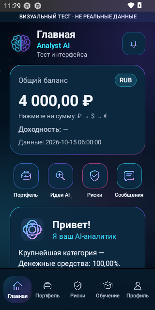
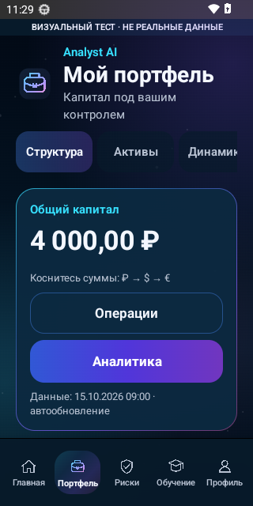
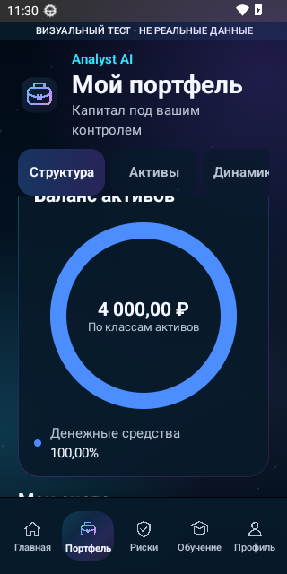
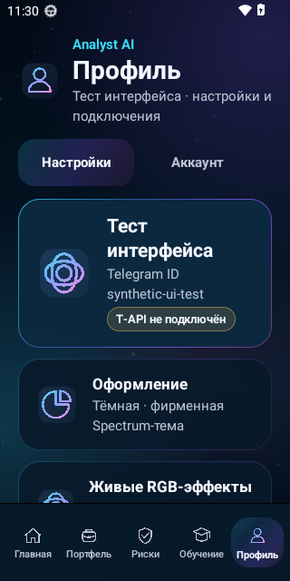

# Analyst AI 0.7.0 — реальные экраны кандидата

Исходный коммит: `4331893603dd73eb436207ed2d8fb8c00e908697`, PR #847.
Проверка: [Android CI, запуск 38726541613, попытка 1](https://github.com/MishaGameHacking/omni-cio-gateway/actions/runs/38726541613/attempts/1).

## Экранные снимки

Это оригинальные PNG из Android-эмулятора, без художественной обработки. HomeScreen и PortfolioScreen — компоненты настоящего приложения; тестовый счёт применяется только в debug-стенде и отмечен на экране. На изображениях нет реального портфеля пользователя.

## Что проверено в попытке 1

Сборка debug/release/preview и lint завершились успешно. Из 224 тестов Python 221 прошёл; 3 проверки символьных ссылок пропущены из-за ограничений Windows. Sonar Quality Gate пройден, но остались четыре некритических замечания (повторяющиеся подписи и захват переменной цикла).

На эмуляторе API 33 прошли чистая установка, обновление поверх опубликованного APK 0.5.1 и запуск через BootstrapActivity. Проверка экранов Главная/Портфель/Структура прошла. Получены снимки светлой и тёмной тем.

Полный UI-прогон НЕ пройден: при восстановлении тёмной темы после перезапуска потеряна связь ADB с эмулятором. До проверки геометрии вкладок, обучения, шрифта 200% и API 36 эта попытка не дошла. Приложенные JSON сохраняют исходный неуспешный результат; их нельзя использовать как разрешение на публикацию.

После сбоя запущена повторная попытка на том же коммите без изменения тестов. Итог повторного запуска проверяется отдельно. Main не изменён; нового опубликованного APK пока нет. Эти изображения не означают полного совпадения с рекламным коллажем или проверки на физическом телефоне.

SHA-256 home.png: `8d9d2dfdba1952b967cdf4566e2fb2a94025dc7549f0734c162a64c055196642`.
SHA-256 portfolio.png: `5b1adff89790b8b1a7e061165a0baadd020d14577414e1b8e15974b98c78ddb5`.
SHA-256 allocation.png: `e64ecace9749a4db218520256e57d26af46eab2d5440d54472dce69f3858be1b`.
